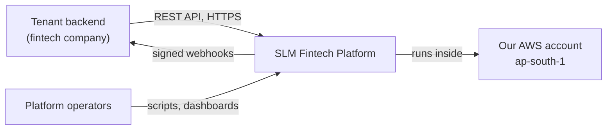
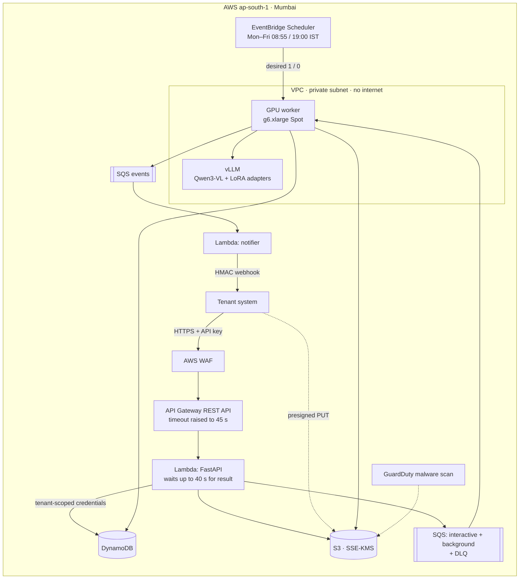
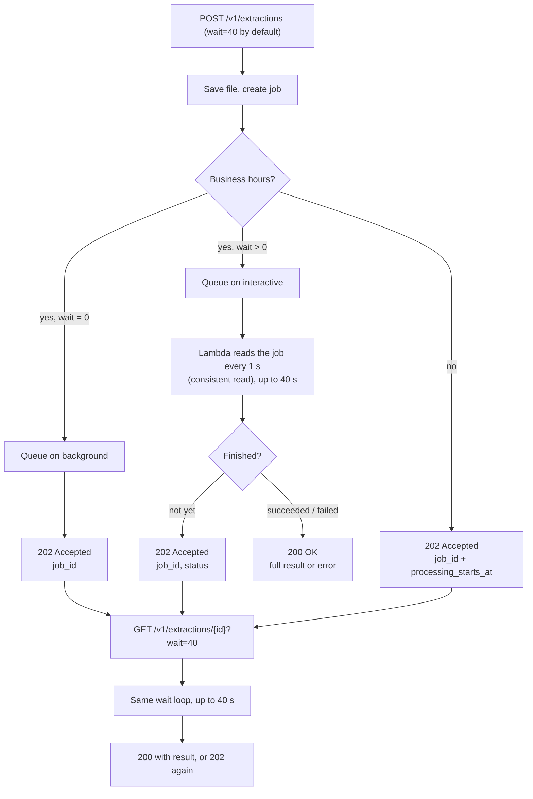
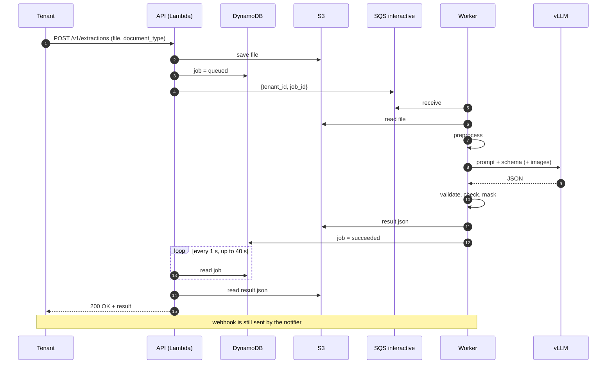
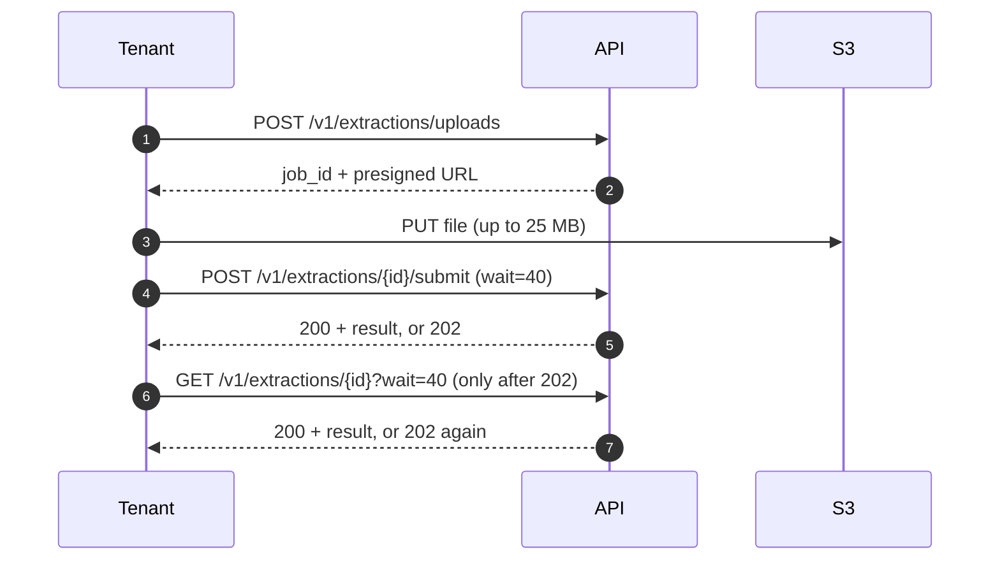
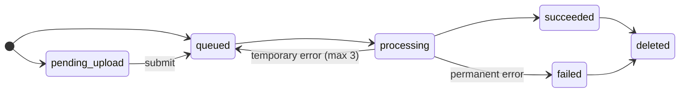
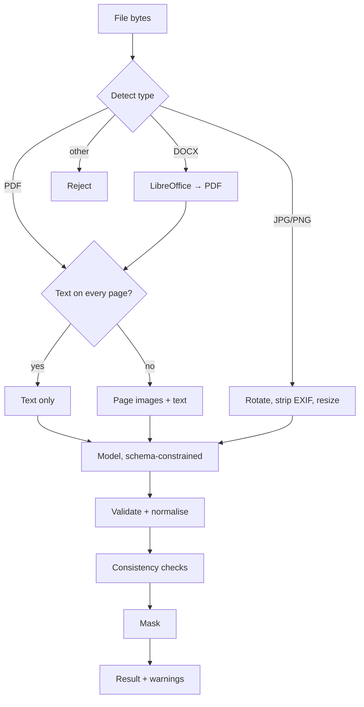
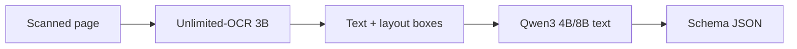
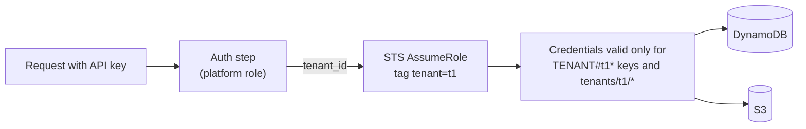
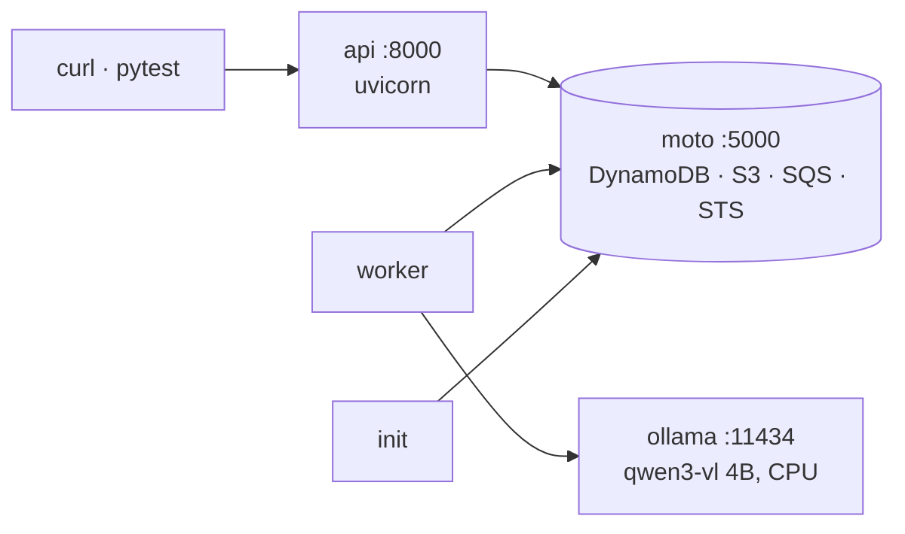

# SLM Fintech Platform: Architecture

| | |
|---|---|
| Version | 0.1 (draft for review) |
| Date | 2026-10-13 |
| Related | [requirements.md](requirements.md), [implementation-guide.md](implementation-guide.md) |

## 1. Overview

The platform is a multi-tenant API on AWS in Mumbai. Tenants send financial documents and receive structured JSON. Extraction is done by a small vision-language model that we host ourselves, so documents never leave our AWS account.

Three ideas shape the design:

1. **Pay only when working.** Everything that waits for requests is serverless. The GPU, the only hourly cost, runs only during business hours.
2. **Isolation enforced by AWS, not only by code.** Each request runs with credentials limited to its tenant's data.
3. **One codebase, two environments.** The same code runs on a laptop with emulated AWS and a CPU model, and in AWS with a GPU.

## 2. System context



No external AI service is called. The only outbound traffic is webhooks to tenants.

## 3. Production architecture



### Components

| Component | Responsibility | Technology | Notes |
|---|---|---|---|
| Edge | TLS, rate limits, IP rules | AWS WAF + API Gateway REST API (regional) | Pay per request. REST API because its integration timeout can be raised above 29 s (needed for the 40 s wait) and WAF attaches to it directly; HTTP API allows neither. |
| API | Auth, tenancy, jobs, results, corrections, waiting for results | Python FastAPI on Lambda (Mangum), timeout 50 s | Runs outside the VPC; no database server to reach |
| Metadata store | Tenants, keys, jobs, usage | DynamoDB on-demand, single table | Point-in-time recovery on |
| File store | Uploads, results, corrections | S3 with SSE-KMS and bucket key | Prefix per tenant; lifecycle by tag |
| Job queues | API to worker handoff | Two SQS standard queues + shared DLQ | `interactive` for jobs a client is waiting on, `background` for the rest. Worker always drains `interactive` first. 4-day retention, 3 receives before DLQ. |
| Worker | Preprocessing, model calls, validation, masking | Python process in ECS on EC2 GPU | Same image as the API code |
| Model server | Inference | vLLM, OpenAI-compatible API | Same instance as the worker |
| Scheduler | Business-hours start and stop | EventBridge Scheduler | Time zone Asia/Kolkata |
| Notifier | Webhooks | Lambda triggered by SQS | Outside the VPC so the GPU subnet needs no internet |
| Security services | Keys, audit, threat detection | KMS, CloudTrail, GuardDuty, Secrets Manager | |

### Network

- The GPU worker runs in a **private subnet with no NAT gateway and no internet route**.
- S3 and DynamoDB are reached through **gateway endpoints** (free).
- SQS, KMS, STS and CloudWatch Logs are reached through **interface endpoints**, about USD 7 each per month in one availability zone.
- The worker's container image and model weights are built into the instance AMI, so no ECR endpoint is needed and the model loads quickly.
- Lambdas run outside the VPC and use AWS public endpoints over TLS.

## 4. Request flow

Create and submit requests **wait up to 40 seconds** for the result. Most documents finish within that time during business hours, so the tenant gets the JSON in the same response. If not, the tenant gets `202` and calls `GET` again, which can also wait up to 40 seconds.



### Sequence (result within the wait)



### Sequence (large file, presigned upload)



### Response rules

| Situation | Response |
|---|---|
| Job finished within the wait | `200 OK` with status `succeeded` and the result, or status `failed` and the error code |
| Still queued or processing after the wait | `202 Accepted` with `job_id` and `status` |
| Outside business hours | `202 Accepted` at once, with `processing_starts_at` |
| `wait=0` | `202 Accepted` at once; job goes to the background queue |

Upload errors (bad key, file too large, unsupported type) still return `4xx` at once, before any waiting.

### Timeouts

| Layer | Setting |
|---|---|
| Wait loop | 40 s maximum, measured from when the job is queued |
| Lambda | 50 s (wait + upload + reading the result) |
| API Gateway REST API integration timeout | 45–50 s; above 29 s needs a Service Quotas increase for the account |
| Tenant HTTP client | at least 55 s recommended |

Multipart uploads are limited to 5 MB because a Lambda request payload is limited to 6 MB. Larger files use the presigned flow.

### Job states



| Error type | Examples | Behaviour |
|---|---|---|
| Permanent | `unsupported_file_type`, `encrypted_pdf`, `too_many_pages`, `corrupt_file`, `conversion_failed`, `model_output_invalid`, `validation_failed` | Job set to `failed` with the code; message deleted from the queue |
| Temporary | Model server not reachable, timeout, Spot interruption | Message returns to the queue after its visibility timeout; after 3 receives it moves to the DLQ and raises an alarm |

## 5. Extraction pipeline



| Stage | Detail |
|---|---|
| Detect | Magic bytes: `%PDF-`, PNG signature, JPEG `FF D8 FF`, ZIP with `word/document.xml`. DOCX with `vbaProject.bin` (macros) is rejected. |
| PDF | pypdfium2 extracts text per page. A page with fewer than 50 characters counts as scanned. If any page is scanned, all pages are rendered at 150 dpi. |
| DOCX | LibreOffice headless converts to PDF in a temporary directory with its own profile, 60-second timeout. |
| Image | Pillow applies EXIF rotation, converts to RGB, limits the long side to 1,600 px and re-encodes as PNG, which drops EXIF data such as GPS. Pixel limit guards against decompression bombs. |
| Prompt | System prompt states that the document is untrusted data. The user message holds the document type description, the text layer inside delimiters and the JSON schema. Page images are attached in order. |
| Model call | OpenAI-compatible `chat/completions` with `response_format` `json_schema`, temperature 0. vLLM's guided decoding forces valid JSON. |
| Validate | Pydantic model per type. Lenient parsers accept Indian date formats and amounts with `₹`, `Rs.` and commas. Errors report field paths only, never values. |
| Checks | Arithmetic and format checks per type, producing warnings. |
| Mask | Field-level rules from schema metadata, plus an Aadhaar pattern scan on identity and KYC documents. |

## 6. AI models

### Release 1

| Role | Model | Serving | Licence |
|---|---|---|---|
| Extraction (production) | Qwen3-VL-8B-Instruct, FP8 | vLLM on NVIDIA L4 24 GB | Apache-2.0 |
| Extraction (cheaper candidate) | Qwen3-VL-4B-Instruct | vLLM, same GPU | Apache-2.0 |
| Extraction (local) | qwen3-vl 4B, quantized | Ollama on CPU | Apache-2.0 |

One model handles text and images, so there is one model to deploy, evaluate and fine-tune. The 8B model in FP8 needs about 10 GB, which leaves room for a 32k context and batching on the L4.

### Candidate to evaluate: two-step OCR

[Baidu Unlimited-OCR](https://github.com/baidu/Unlimited-OCR) (3B, MIT licence, released June 2026) converts page images to text with layout boxes. It does not produce our JSON fields, so it could only be an OCR step in front of a text model:



| Benefit | Cost |
|---|---|
| Possibly better on dense or poor scans | Two models to run, evaluate and fine-tune |
| Layout boxes allow showing where each field came from | Needs CUDA; cannot run on development laptops |
| Text-only second step is cheaper per page | Loads with `trust_remote_code`; code must be pinned and reviewed |
| | No published table or Indian-language results |

It is tested in phase 3 as **pipeline B** on scanned documents only. It replaces pipeline A only if it is clearly more accurate on scanned bank statements and ID documents.

### Later phases

| Role | Model |
|---|---|
| Per-tenant fine-tuning | QLoRA adapters on the chosen Qwen3-VL, served by vLLM's multi-LoRA support |
| Chat | Same Qwen3-VL instance, or Qwen3-8B text |
| Embeddings | multilingual-e5-small or bge-m3 on CPU |
| Vector store | Amazon S3 Vectors (check availability in ap-south-1) |

### Model gateway

All model calls go through one interface, so the rest of the code never knows which server or model is used.

```python
class ModelProvider(Protocol):
    def extract(self, request: ExtractionRequest) -> ModelResponse: ...
```

| Provider | Used for |
|---|---|
| `openai_compatible` | vLLM in AWS, Ollama locally |
| `fake` | Tests and quick local runs; returns canned JSON |

The request carries an optional `adapter` name. vLLM serves each tenant's LoRA adapter under its own model name, so routing a tenant to its adapter is a single field.

## 7. Multi-tenancy

### Identity

1. API keys look like `slm_live_<43 random chars>`. Only the SHA-256 hash is stored; the key has enough randomness that a slow hash is not needed.
2. Auth reads `APIKEY#<hash>`, checks the key and tenant are active, and builds a `TenantContext` (tenant ID, key ID, scopes, settings).
3. Every service function takes the `TenantContext`. There is no function that accepts a tenant ID from request data.

### Isolation in AWS



The tenant role's policy:

- DynamoDB: `dynamodb:LeadingKeys` must match `TENANT#${aws:PrincipalTag/tenant}*`.
- S3: object keys must start with `tenants/${aws:PrincipalTag/tenant}/`.

Credentials are cached per tenant for up to 15 minutes in each Lambda instance. Locally, this step is off and isolation relies on key prefixes in code. The isolation tests run in both modes.

### Data model

Single DynamoDB table `slm-fintech`, keys `PK` and `SK`, index `GSI1` (`GSI1PK`, `GSI1SK`), TTL attribute `ttl`.

| Entity | PK | SK | GSI1PK / GSI1SK | Attributes |
|---|---|---|---|---|
| API key | `APIKEY#<sha256>` | `META` | | tenant_id, key_id, scopes, status, created_at |
| Tenant | `TENANT#<id>` | `META` | | name, status, retention_days, training_consent, training_consent_at, unmask_fields, webhook_url, model_adapter |
| Job | `TENANT#<id>#JOB#<job_id>` | `META` | `TENANT#<id>` / `JOB#<created_at>#<job_id>` | document_type, schema_version, status, content_type, size, sha256, pages, warnings, error_code, model, input_key, result_key, retained_for_training, corrections_count, ttl |
| File hash | `TENANT#<id>` | `FILEHASH#<sha256>#<type>#<version>` | | job_id |
| Usage | `TENANT#<id>` | `USAGE#<yyyy-mm-dd>` | | pages, model_ms, jobs |
| Chat message (later) | `TENANT#<id>#CHAT#<session>` | `MSG#<ts>` | | |

Jobs get their own partition key so a busy tenant does not concentrate traffic on one partition. Webhook secrets are stored in Secrets Manager under `slm/tenants/<id>/webhook`, not in the table.

### S3 layout

```
s3://slm-fintech-docs/
  tenants/<tenant_id>/jobs/<job_id>/input
  tenants/<tenant_id>/jobs/<job_id>/result.json
  tenants/<tenant_id>/jobs/<job_id>/corrections/<ulid>.json
```

Every object has a `retention` tag (`7d`, `30d`, `90d`, `365d`). One lifecycle rule per tag value deletes objects after that period. Training exports copy consented files to a separate bucket, `slm-fintech-training`, which only the training role can read.

## 8. Security

| Threat | Control |
|---|---|
| Tenant reads another tenant's data | Tenant from API key only; IAM-scoped credentials; isolation tests |
| Stolen API key | Hash-only storage, per-key revocation, scopes, optional IP allowlist, audit log |
| Data leaks through logs | No content, values or file names in logs; custom validation error handler; log review in code review |
| Malicious file | Type detection from bytes, page and size limits, macro rejection, image pixel limit, GuardDuty malware scan, LibreOffice in a sandboxed temp profile |
| Prompt injection in a document | Model has no tools, output constrained to schema, document marked as untrusted |
| Model server exposed | Private subnet, no internet, security group allows only the worker |
| Webhook spoofing | HMAC-SHA256 signature with timestamp: `X-SLM-Signature: t=<unix>,v1=<hex>` |
| Data leaving India | Single region; organisation policy denies other regions |
| Cross-tenant leak through training | One LoRA adapter per tenant; base model trained only on de-identified or synthetic data |

Encryption: one customer-managed KMS key for S3, DynamoDB and SQS. Each S3 request includes the tenant ID in the encryption context where supported. Dedicated keys per tenant can be offered as a paid option.

## 9. Business-hours operation

| Time (IST, Mon–Fri) | Event |
|---|---|
| 08:55 | Scheduler sets GPU service desired count to 1. Instance starts and loads the model (about 2–3 minutes). |
| 09:00 | Worker starts reading the queue, including anything left overnight. |
| 18:55 | Worker stops taking new messages and finishes current ones. |
| 19:00 | Scheduler sets desired count to 0. Instance terminates. |

- Outside those hours, the API keeps accepting jobs and returns `processing_starts_at`.
- Spot interruption gives a 2-minute warning. The worker stops taking messages; unfinished messages return to the queue. The capacity provider replaces the instance, falling back to on-demand.
- The window is set by `SLM_BUSINESS_*` settings and the scheduler's cron expressions, both generated from the same Terraform variables.

## 10. Observability

| Signal | Source | Alarm |
|---|---|---|
| Queue depth and oldest message age | SQS metrics | Oldest message older than 30 minutes during business hours |
| DLQ messages | SQS metrics | Any message |
| Job failures by error code | Structured logs, metric filter | Failure rate above 5% in an hour |
| Model latency per page | Worker logs | p95 above target |
| GPU instance running outside hours | ECS metrics | Running between 19:10 and 08:50 |
| Spend | AWS Budgets | 80% and 100% of the monthly target |

Logs are JSON. Application logs are kept 14 days. Audit and security logs go to S3 in ap-south-1 and are kept 180 days.

## 11. Local environment



| | Local | AWS |
|---|---|---|
| API runtime | uvicorn | Lambda |
| AWS services | moto server | real services |
| Model server | Ollama on CPU, or fake provider | vLLM on L4 |
| Tenant isolation | key prefixes in code | key prefixes + IAM |
| Business hours | off | on |
| Secrets | `.env` | Secrets Manager |

## 12. Cost

| Item | USD / month at 1,000 pages/day |
|---|---|
| GPU, g6.xlarge Spot, ~220 h | 70–90 |
| VPC interface endpoints | ~30 |
| Lambda, API Gateway, SQS, DynamoDB | 5–10 |
| S3, KMS, CloudWatch, GuardDuty | 5–10 |
| **Total** | **~110–140** |

These figures are estimates; confirm them in the AWS Pricing Calculator for ap-south-1. If g6 Spot capacity is short in Mumbai, g5 or g4dn are the fallbacks; g4dn (T4) needs the 4B model in 4-bit AWQ because it lacks FP8.

## 13. Decisions

| # | Decision | Alternatives considered | Reason |
|---|---|---|---|
| D1 | Self-hosted model | Bedrock, public LLM APIs | Data stays in our account; client trust |
| D2 | AWS ap-south-1 | us-east-1 (~10–20% cheaper GPU) | RBI localisation and client contracts |
| D3 | DynamoDB | RDS Postgres with row-level security | No idle cost; IAM key-prefix isolation |
| D4 | Queue-based jobs; API waits up to 40 s and returns the result when ready, else `202` | Fully synchronous (Lambda calls the GPU); async only | One processing path for all cases. Most documents return in one call; long scans and off-hours requests still work. |
| D5 | Business-hours GPU, Spot | 24/7, batch windows | Results in seconds during the day at about USD 70–90 a month |
| D6 | One VLM for all inputs | OCR + text LLM | One model to run and improve; two-step kept as candidate B |
| D7 | Lambda API outside VPC | Fargate + ALB | No idle cost; no endpoints needed for the API |
| D8 | pypdfium2 | PyMuPDF | PyMuPDF is AGPL |
| D9 | Per-tenant LoRA adapters | One shared fine-tuned model | Prevents one tenant's data appearing in another's output |
| D10 | Webhooks from a Lambda | From the worker | Keeps the GPU subnet without internet |
| D11 | API Gateway REST API | HTTP API (cheaper per request) | HTTP API has a fixed 30 s timeout and no direct WAF support. Extra cost is cents per month at our volume. |
| D12 | Separate interactive and background queues | One queue | A waiting client is not stuck behind the overnight backlog at 09:00 |

## 14. Risks

| Risk | Impact | Mitigation |
|---|---|---|
| Model accuracy below target on scans | Tenants reject results | Phase 3 evaluation, pipeline B, LoRA fine-tuning |
| g6 Spot capacity short in Mumbai | Delays or higher cost | On-demand fallback; g5/g4dn instance types |
| Slow CPU inference locally | Slow development feedback | Fake provider for most work; cloud GPU for accuracy runs |
| Long bank statements exceed output tokens | Truncated transactions | 8,192 max tokens; split by page range in a later version |
| Waiting requests hold Lambda instances for up to 40 s | Lambda concurrency limit reached at peaks (new accounts can start at a low limit) | Request a concurrency increase before the pilot; at ~250 documents a day concurrency stays in single digits |
| Integration timeout above 29 s not granted | 40 s wait not possible | Request the quota in phase 4 week 1. If refused: replace API Gateway with CloudFront + WAF in front of a Lambda Function URL (origin timeout up to 60 s, Lambda up to 15 min), or fall back to a 25 s wait. The application code does not change. |
| Raising the timeout lowers the account's API Gateway throttle quota | Lower peak request rate | Our volume (hundreds of requests a day) is far below any throttle limit |
| Regulation interpreted wrongly | Legal exposure | Counsel review before pilot |
