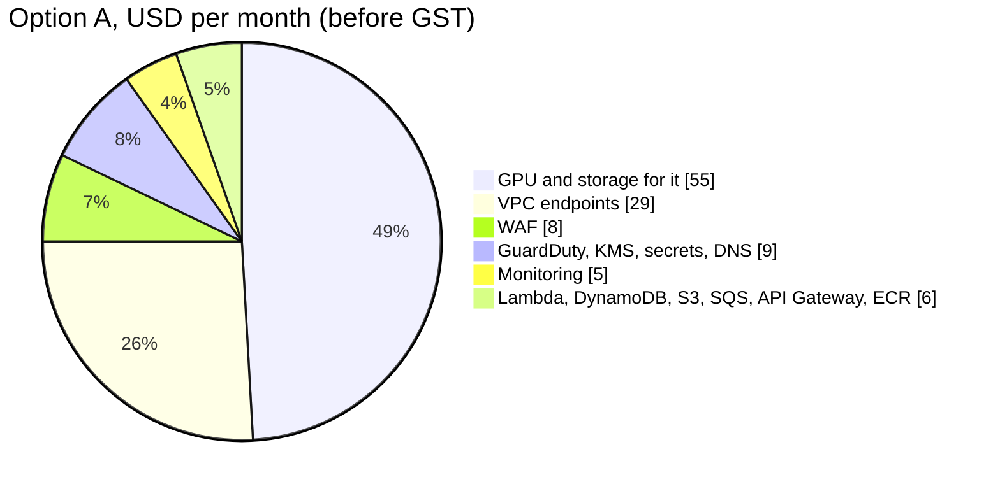

# SLM Fintech Platform: Cost Estimate

| | |
|---|---|
| Version | 0.1 (draft for review) |
| Date | 2026-10-13 |
| Region | AWS ap-south-1 (Mumbai) |
| Volume | 1,000 pages per day |
| Prices | AWS public price list and Spot pricing data, fetched 2026-10-13 |
| Related | [architecture.md](architecture.md), [requirements.md](requirements.md) |

All amounts are in USD per month, **before 18% GST**. AWS accounts in India are billed by AWS India (AISPL), which adds GST.

## 1. Summary

| Option | GPU | Monthly (USD, before GST) | With 18% GST | Per page |
|---|---|---|---|---|
| **A. Recommended start** | g4dn.xlarge (T4) Spot, on-demand fallback | **≈ 112** | ≈ 132 | ≈ $0.0037 (≈ ₹0.33) |
| B. No Spot risk | g4dn.xlarge (T4) on-demand | ≈ 187 | ≈ 221 | ≈ $0.0062 |
| C. Faster GPU, Spot | g5.xlarge (A10G) Spot | ≈ 171 | ≈ 202 | ≈ $0.0057 |
| D. Original design | g6.xlarge (L4) on-demand | ≈ 272 | ≈ 321 | ≈ $0.0091 |

Rupee figures use ₹88 per USD (assumption).

**Changes from the earlier estimate (USD 110–140, g6 Spot):**

1. **No g6 Spot price is listed for Mumbai.** AWS's Spot pricing data has g6 Spot prices for us-east-1, but not for ap-south-1, and g6 on-demand in Mumbai is USD 0.97/hour. Check Spot availability for g6 in the EC2 console before planning on it.
2. **g4dn.xlarge Spot is the cheapest suitable GPU in Mumbai** at about USD 0.19/hour. At 1,000 pages a day the GPU is mostly idle, so a slower GPU is acceptable. The T4 has no FP8, so it runs Qwen3-VL-4B or 8B in 4-bit AWQ.
3. **Running the worker in ECS would need more VPC endpoints than estimated.** The ECS agent needs three extra endpoints. A plain EC2 Auto Scaling group avoids them and saves about USD 38 a month (section 4.2).

## 2. Volume assumptions

| Assumption | Value |
|---|---|
| Pages per day | 1,000 (every calendar day, processed on weekdays) |
| Pages per month | 30,000 |
| Average pages per document | 4 |
| Documents per month | 7,500 |
| Average upload size | 0.5 MB (digital PDFs smaller, scans larger) |
| API calls per document | 1 upload + 0.5 GET on average |
| Average Lambda wait on upload | 20 s (max 40 s) |
| Tenants | 5 |
| Retention | 30 days for files without training consent |
| GPU hours | Mon–Fri 08:55–19:00 IST ≈ 10.1 h × 21.7 weekdays ≈ **218 h/month** |

## 3. Unit prices used (ap-south-1)

| Service | Price |
|---|---|
| EC2 g4dn.xlarge (T4 16 GB) | $0.579/h on-demand · ≈ $0.19/h Spot |
| EC2 g5.xlarge (A10G 24 GB) | $1.208/h on-demand · ≈ $0.51/h Spot |
| EC2 g6.xlarge (L4 24 GB) | $0.966/h on-demand · Spot not listed in Mumbai |
| VPC interface endpoint | $0.013 per hour per endpoint per AZ (≈ $9.49/month) · $0.01/GB processed |
| VPC gateway endpoint (S3, DynamoDB) | free |
| API Gateway REST API | $3.50 per million requests |
| Lambda (x86) | $0.0000166667 per GB-second · $0.20 per million requests · free tier 400,000 GB-s and 1M requests |
| DynamoDB on-demand | $0.71 per million writes · $0.1425 per million reads · 25 GB storage free · PITR $0.228/GB-month |
| S3 Standard | $0.025/GB-month · $0.005 per 1,000 PUT · $0.004 per 10,000 GET |
| S3 Glacier Instant Retrieval | $0.005/GB-month |
| SQS standard | $0.40 per million requests · first 1M free |
| KMS | $1 per key-month · $0.03 per 10,000 requests |
| Secrets Manager | $0.40 per secret-month |
| WAF | $5 per web ACL-month · $1 per rule-month · $0.60 per million requests |
| GuardDuty Malware Protection for S3 | first 1,000 objects and 1 GB free, then $0.000271 per object and $0.1125/GB |
| CloudWatch | logs $0.67/GB ingested, $0.03/GB-month stored · alarms $0.10 each · custom metrics $0.30 each |

Spot prices change continuously; the values above are a snapshot. EBS and snapshot prices are approximate.

## 4. Detailed estimate (option A)

### 4.1 Compute and AI

| Item | Calculation | USD/month |
|---|---|---|
| GPU worker, g4dn.xlarge | 196 h Spot × $0.19 + 22 h on-demand fallback × $0.579 (assumes 10% of hours on on-demand) | 50.0 |
| EBS root volume while running | 100 GB gp3, 218 h of 730 | ≈ 3 |
| AMI snapshot with model weights | ≈ 35 GB | ≈ 2 |
| Lambda: API | 7,500 uploads × 20 s + 3,750 GETs × 5 s, 512 MB ≈ 85,000 GB-s (within free tier) | 0–1.5 |
| Lambda: notifier | 7,500 short calls | < 0.1 |
| ECR images | ≈ 8 GB | ≈ 1 |
| **Subtotal** | | **≈ 57** |

### 4.2 Network

| Item | Calculation | USD/month |
|---|---|---|
| Interface endpoints: SQS, STS, CloudWatch Logs | 3 × $9.49 | 28.5 |
| Gateway endpoints: S3, DynamoDB | free | 0 |
| Endpoint data processed | ≈ 5 GB × $0.01 | < 0.1 |
| Data transfer out (responses, webhooks) | well under the 100 GB free tier | 0 |
| NAT gateway | not used | 0 |
| **Subtotal** | | **≈ 29** |

Notes:

- A KMS endpoint is not needed. S3 and DynamoDB call KMS themselves for server-side encryption.
- If the worker runs in **ECS**, add `ecs`, `ecs-agent` and `ecs-telemetry` endpoints (+$28.5). Pulling images at start also needs `ecr.api` and `ecr.dkr` (+$19). Running the worker as a plain **EC2 Auto Scaling group** with images baked into the AMI avoids all five. The scheduler then sets the group's desired capacity to 1 or 0.

### 4.3 Data and messaging

| Item | Calculation | USD/month |
|---|---|---|
| DynamoDB writes | 7,500 jobs × ~6 writes = 45,000 | < 0.1 |
| DynamoDB reads | auth + wait polling (1 strongly consistent read per second while waiting) ≈ 250,000 | < 0.1 |
| DynamoDB storage + PITR | < 1 GB | ≈ 0.3 |
| S3 storage | ≈ 4 GB at 30-day retention | ≈ 0.1 |
| S3 requests | ≈ 30,000 PUT + 25,000 GET | ≈ 0.2 |
| SQS | worker polling during business hours (≈ 8M requests) + messages | ≈ 3 |
| **Subtotal** | | **≈ 4** |

### 4.4 Edge and security

| Item | Calculation | USD/month |
|---|---|---|
| API Gateway REST API | ≈ 15,000 requests | < 0.1 |
| WAF | 1 web ACL + 3 rules/rule groups + requests | ≈ 8 |
| KMS | 1 key + ≈ 50,000 requests | ≈ 1.2 |
| Secrets Manager | 5 tenant webhook secrets + 2 platform secrets | 2.8 |
| GuardDuty Malware Protection for S3 | 6,500 objects beyond free tier × $0.000271 + ≈ 3 GB × $0.1125 | ≈ 2.1 |
| GuardDuty threat detection (CloudTrail, VPC flow, DNS) | low event volume | ≈ 1–3 |
| CloudTrail | management events, first trail | 0 |
| Route 53 hosted zone (API domain) | | 0.5 |
| **Subtotal** | | **≈ 17** |

### 4.5 Monitoring

| Item | Calculation | USD/month |
|---|---|---|
| CloudWatch Logs | ≈ 1 GB ingested, 14-day retention | ≈ 0.7 |
| Audit and security logs in S3 | 180 days, < 1 GB | < 0.1 |
| Alarms | 8 × $0.10 | 0.8 |
| Custom metrics | ≈ 10 × $0.30 | 3 |
| Dashboard | first 3 free | 0 |
| AWS Budgets | first 2 budgets free | 0 |
| **Subtotal** | | **≈ 5** |

### 4.6 Total

| Group | USD/month |
|---|---|
| Compute and AI | 57 |
| Network | 29 |
| Data and messaging | 4 |
| Edge and security | 17 |
| Monitoring | 5 |
| **Total before GST** | **≈ 112** |
| GST 18% | ≈ 20 |
| **Total with GST** | **≈ 132** |

## 5. Where the money goes

About **half the cost is the GPU** and a quarter is the private network endpoints. Lambda, DynamoDB, S3 and API Gateway together cost only a few dollars at this volume.

## 6. Fixed and variable costs

| Type | Items | USD/month |
|---|---|---|
| Fixed (paid even with zero documents) | VPC endpoints, WAF, KMS key, secrets, alarms, metrics, Route 53, ECR, AMI snapshot | ≈ 50 |
| Business-hours fixed (paid whenever the GPU runs) | GPU, EBS, SQS polling | ≈ 56 |
| Variable (per document) | Lambda, API Gateway, DynamoDB, S3, GuardDuty scans, logs | ≈ 5 at 1,000 pages/day |

Because almost everything is fixed, cost per page falls quickly as volume grows:

| Pages per day | Monthly (option A, before GST) | Per page |
|---|---|---|
| 100 | ≈ 107 | $0.036 |
| 1,000 | ≈ 112 | $0.0037 |
| 5,000 | ≈ 135 | $0.0009 |
| 10,000 | ≈ 165 + possibly a second GPU or a faster one | ≈ $0.0006 |

At 5,000 pages a day the same single GPU still has spare capacity in a 10-hour day; this must be confirmed by the phase 3 benchmark.

## 7. GPU choice

| | g4dn.xlarge (T4) | g5.xlarge (A10G) | g6.xlarge (L4) |
|---|---|---|---|
| GPU memory | 16 GB | 24 GB | 24 GB |
| FP8 | no | no | yes |
| Model setup | Qwen3-VL 4B or 8B, 4-bit AWQ | 4B or 8B, AWQ or BF16 (4B) | 8B FP8 |
| Relative speed (estimate) | 1× | ≈ 2–3× | ≈ 2–3× |
| On-demand $/h (Mumbai) | 0.579 | 1.208 | 0.966 |
| Spot $/h (Mumbai) | ≈ 0.19 | ≈ 0.51 | not listed |
| GPU cost, 218 h, Spot | ≈ $41–50 | ≈ $110 | — |
| GPU cost, 218 h, on-demand | $126 | $263 | $211 |

**Recommendation:** start with **g4dn.xlarge Spot**. Allow g5.xlarge and g6.xlarge as alternatives in the Auto Scaling group so a Spot shortage does not stop processing. Move to a faster GPU only if phase 3 shows:

- accuracy needs the 8B model at higher precision than 4-bit, or
- too many requests miss the 40-second wait on the T4 (scanned multi-page documents are the risk).

**Savings Plans do not help.** They charge a fixed hourly commitment around the clock, and our GPU runs only 30% of the hours.

## 8. One-off and occasional costs

| Item | Estimate |
|---|---|
| Phase 3 accuracy runs (about 10 GPU hours on g6/g5 on-demand) | ≈ $10–15 |
| LoRA fine-tuning run per tenant adapter (3–6 GPU hours) | ≈ $2–6 each |
| Training data bucket (Glacier Instant Retrieval, 50 GB) | ≈ $0.25/month |
| Staging environment: fixed costs only, GPU on demand for tests | ≈ $40–50/month, or $0 if destroyed when idle |
| Local development | $0 (docker-compose, moto, Ollama) |

## 9. Not included

| Item | Typical cost | When needed |
|---|---|---|
| AWS Support (Developer / Business) | $29 / from $100 per month | Business support recommended before production clients |
| AWS Security Hub, AWS Config | ≈ $5–20/month at this size | If a client's audit asks for it |
| Penetration test, legal review | one-off, external | Before pilot |
| Second region for disaster recovery (ap-south-2) | ≈ +$40/month standby | Later |
| Domain name registration | ≈ $10–15/year | Once |

## 10. Ways to cut further

| Change | Saves | Trade-off |
|---|---|---|
| Create the 3 interface endpoints only during business hours (scheduled with the GPU) | ≈ $20/month | More moving parts at start-up; endpoints take 1–2 minutes to become ready |
| Drop the WAF and rely on API Gateway throttling | ≈ $8/month | Weaker protection; fintech clients will likely ask for WAF |
| Process 3 days a week instead of 5 | ≈ $20/month on GPU | Slower results |
| Use Graviton (ARM) Lambda | ≈ 20% of a small Lambda bill | Build ARM images |

Things not to cut: KMS encryption, GuardDuty malware scanning, audit logs. They cost a few dollars a month and are what clients and auditors check first.

## 11. Cost controls

1. AWS Budget at USD 150/month with alerts at 80% and 100%.
2. Alarm if a GPU instance is running between 19:10 and 08:50 IST or on a weekend.
3. Cost allocation tags on every resource: `project=slm-fintech`, `env`, `component`.
4. Monthly review of GPU hours, Spot vs on-demand share, and per-tenant usage counters (pages, model seconds) for billing.

## 12. Decisions this document asks for

| Decision | Recommendation | Changes in other docs |
|---|---|---|
| GPU instance | g4dn.xlarge Spot, with g5/g6 as fallbacks | architecture.md §3, §6, §12; implementation-guide.md §8.3, §9 |
| Worker runtime | EC2 Auto Scaling group instead of ECS | architecture.md §3; implementation-guide.md §9.1, §9.3 |
| Monthly budget | USD 150 before GST | requirements.md NFR-K1 |
