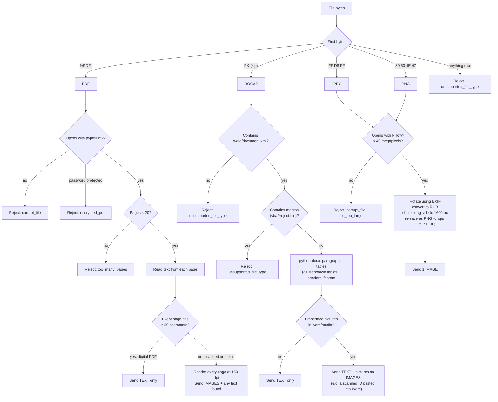
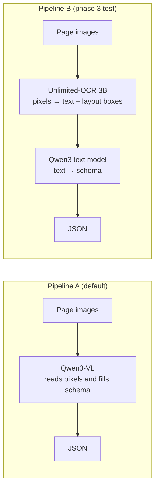

# SLM Fintech Platform: Processing Flow

| | |
|---|---|
| Version | 0.1 (draft for review) |
| Date | 2026-10-13 |
| Related | [architecture.md](architecture.md), [implementation-guide.md](implementation-guide.md) |

This document follows one document from upload to result, and shows what happens to each file type. DOCX handling uses python-docx (recommended in place of LibreOffice, pending sign-off).

## 1. Key idea

The AI model accepts only **text** and **images**. Every file is first turned into one or both of those:

| File | What it really contains | What the model receives |
|---|---|---|
| Digital PDF | Text + layout | Text |
| Scanned PDF | Pictures of pages | Page images (+ any text found) |
| DOCX | Text, tables, sometimes pasted pictures | Text (+ embedded pictures, if any) |
| JPG / PNG | A picture | One image |

OCR (reading text from pixels) is only needed for the image cases. Qwen3-VL does that itself. Unlimited-OCR is a candidate for that step (pipeline B, section 5).

## 2. End-to-end flow

```mermaid
flowchart TD
  subgraph S1["1 · Upload (API, 24/7)"]
    C["Tenant system"] --> U{"Upload method"}
    U -->|"≤ 5 MB"| D1["POST /v1/extractions<br/>multipart"]
    U -->|"≤ 25 MB"| D2["POST /v1/extractions/uploads<br/>→ presigned URL → PUT to S3<br/>→ POST …/submit"]
    D1 --> AU["Check API key → tenant<br/>check scope"]
    D2 --> AU
    AU --> V1{"Size OK?<br/>document_type known?<br/>file bytes look like PDF/DOCX/JPG/PNG?"}
    V1 -->|no| E1["400 / 413 / 415 error"]
    V1 -->|yes| ST["Save file to S3<br/>tenants/&lt;id&gt;/jobs/&lt;job&gt;/input"]
    ST --> JB["Create job in DynamoDB<br/>status = queued"]
    JB --> BH{"Business hours?"}
    BH -->|no| R1["202 Accepted at once<br/>job_id + processing_starts_at"]
    BH -->|yes| Q["Send {tenant_id, job_id} to SQS<br/>interactive queue (wait > 0)<br/>or background queue (wait = 0)"]
    Q --> WT["API waits up to 40 s<br/>re-reading the job every 1 s"]
  end
  R1 -. "next working day 09:00" .-> Q

  ST -. "async" .-> GD["GuardDuty scans file<br/>tags result on the S3 object"]

  subgraph S2["2 · Pick up (worker, Mon–Fri 09:00–19:00 IST)"]
    Q --> W["Worker receives message"]
    W --> J{"Job still queued?"}
    J -->|"no (duplicate)"| SKIP["Ignore, delete message"]
    J -->|yes| MS{"Malware scan tag"}
    MS -->|"not scanned yet"| RETRY["Leave message<br/>retry in a few minutes"]
    MS -->|"threat found"| E2["Job failed:<br/>malware_detected"]
    MS -->|clean| DL["Download file<br/>status = processing"]
    DL --> H{"Same file processed<br/>before for this tenant?"}
    H -->|yes| CACHE["Reuse earlier result<br/>(no model call)"]
  end

  H -->|no| DET

  subgraph S3["3 · Prepare (by file type, see section 3)"]
    DET{"Detect type<br/>from file bytes"}
    DET -->|PDF| PDF["PDF path"]
    DET -->|DOCX| DOCX["DOCX path"]
    DET -->|"JPG / PNG"| IMG["Image path"]
    PDF --> PREP["Prepared document:<br/>text and/or page images"]
    DOCX --> PREP
    IMG --> PREP
  end

  subgraph S4["4 · Extract (AI model)"]
    PREP --> PR["Build prompt:<br/>• rules (document is untrusted)<br/>• document type description<br/>• text inside &lt;document&gt;<br/>• JSON schema"]
    PR --> GW["Model gateway"]
    GW --> M["Qwen3-VL on vLLM (AWS)<br/>or Ollama (local)<br/>output forced to schema"]
    M --> OUT{"Model response"}
    OUT -->|"server down / timeout"| RETRY2["Leave message → retry<br/>(max 3, then dead-letter queue)"]
    OUT -->|"truncated / not JSON"| E3["Job failed:<br/>model_output_invalid"]
    OUT -->|JSON| VAL
  end

  subgraph S5["5 · Check and protect"]
    VAL{"Validate against schema<br/>(normalise dates, amounts)"}
    VAL -->|fails| E4["Job failed:<br/>validation_failed (field names only)"]
    VAL -->|ok| CHK["Consistency checks → warnings<br/>totals, balances, PAN format, expiry"]
    CHK --> MASK["Masking<br/>Aadhaar always · PAN, account, UAN,<br/>ID no., phone unless tenant allowed"]
  end

  CACHE --> SAVE

  subgraph S6["6 · Store and notify"]
    MASK --> SAVE["Save result.json to S3"]
    SAVE --> KEEP{"Tenant consented to training<br/>AND type allows training?"}
    KEEP -->|yes| K1["Keep original file<br/>(until retention expires)"]
    KEEP -->|no| K2["Delete original file now"]
    K1 --> DONE["Job succeeded<br/>pages, warnings, model recorded<br/>usage counters updated"]
    K2 --> DONE
    DONE --> EV["Completion event → notifier Lambda"]
    EV --> WH["Signed webhook to tenant<br/>(job_id + status only)"]
  end

  DONE --> FIN{"Finished within<br/>the 40 s wait?"}
  WT --> FIN
  FIN -->|yes| R200["200 OK in the same response<br/>status + warnings + masked JSON result"]
  FIN -->|no| R202["202 Accepted<br/>job_id + status"]
  R202 --> G["Tenant calls again:<br/>GET /v1/extractions/{id}?wait=40"]
  G --> FIN2{"Finished within<br/>this wait?"}
  FIN2 -->|yes| RES["200 OK<br/>status + warnings + masked JSON result"]
  FIN2 -->|no| R202
```



Failed jobs also return `200` when they finish within the wait, with `status: "failed"` and the error code instead of a result.

## 3. File-type paths

### 3.1 Overview



### 3.2 PDF

| Step | What happens | Why |
|---|---|---|
| Open | pypdfium2 (Apache/BSD licence) | PyMuPDF is AGPL |
| Encrypted | Rejected with `encrypted_pdf` | We never ask tenants for passwords |
| Page limit | More than 20 pages rejected with `too_many_pages` | Keeps GPU time and output size bounded |
| Text check | Count characters on each page | Decides digital or scanned |
| Digital (all pages have text) | Text only, marked `--- Page 1 ---` etc. | Text uses far fewer tokens than images: faster and cheaper, and no OCR errors |
| Scanned or mixed | All pages rendered to PNG at 150 dpi; any text found is also sent | The model reads pixels; partial text helps it |
| Pages billed | Actual PDF page count | |

Example: a 4-page digital bank statement is about 3–6k input tokens as text. The same statement scanned is roughly 10k image tokens.

### 3.3 DOCX

| Step | What happens | Why |
|---|---|---|
| Check | Must be a zip with `word/document.xml` | Rejects other zip files renamed to .docx |
| Macros | Files with `vbaProject.bin` rejected | Macro-enabled files are a malware risk |
| Text | python-docx reads paragraphs, tables (as Markdown tables), headers and footers in order | DOCX already holds real text; no OCR needed |
| Pictures | Images in `word/media/` are sent as images, resized like JPG/PNG | Some people paste a scanned document into Word |
| Pages billed | Estimated: 1 page per 3,000 characters, plus 1 per embedded picture | DOCX has no fixed pages |

Older `.doc` files (Word 97–2003) are not supported in release 1. They are rare in fintech uploads; tenants can save as DOCX or PDF.

### 3.4 JPG and PNG

| Step | What happens | Why |
|---|---|---|
| Open | Pillow, with a 40-megapixel limit | Blocks "decompression bomb" files |
| Rotate | Apply the EXIF orientation | Phone photos are often stored sideways |
| Clean | Convert to RGB and re-save as PNG | Removes EXIF metadata such as GPS location |
| Resize | Long side at most 1,600 px | Enough to read text; fewer image tokens |
| Pages billed | 1 | |

Typical sources: phone photos of ID cards, KYC forms, payslips.

## 4. What the model receives

Every path ends in the same request shape:

```text
SYSTEM:  extraction rules (document is untrusted, null when missing, date and number formats)

USER:    Document type: GST tax invoice
         Pages: 2
         <document>
         --- Page 1 ---
         TAX INVOICE  Invoice No: INV/2026-27/0412 ...
         --- Page 2 ---
         ...
         </document>
         JSON schema: { ... }
         [page image 1] [page image 2]        ← only for scanned PDFs, pictures, photos
```

| File | `<document>` text | Images |
|---|---|---|
| Digital PDF | full text | none |
| Scanned PDF | whatever text exists (often none) | one per page |
| DOCX | full text with tables | embedded pictures, if any |
| JPG / PNG | none | one |

vLLM forces the reply to match the JSON schema for the document type, so the output always parses.

## 5. Pipeline B (candidate): Unlimited-OCR for image inputs

Only the image cases change. Digital PDFs and DOCX stay on the text path because they need no OCR.



| | Pipeline A | Pipeline B |
|---|---|---|
| Models | 1 | 2 |
| Runs on a laptop | yes (Ollama, CPU) | no (needs NVIDIA GPU) |
| Field locations on the page | no | yes, from layout boxes |
| Decided by | phase 3 accuracy test on scanned bank statements and ID documents |

## 6. Where each error comes from

| Code | Stage | HTTP / job | Retried |
|---|---|---|---|
| `unauthorized` | Upload | 401 | no |
| `unknown_document_type` | Upload | 400 | no |
| `file_too_large` | Upload or image path | 413 / job failed | no |
| `unsupported_file_type` | Upload or type check | 415 / job failed | no |
| `malware_detected` | Pick up | job failed | no |
| `corrupt_file` | Type path | job failed | no |
| `encrypted_pdf` | PDF path | job failed | no |
| `too_many_pages` | PDF path | job failed | no |
| `model_output_invalid` | Extract | job failed | no |
| `validation_failed` | Check | job failed | no |
| Model server unavailable | Extract | stays queued | yes, 3 times, then dead-letter queue |
| Malware scan pending | Pick up | stays queued | yes |

## 7. Timing (estimates, to be measured in phase 3)

| Input (4 pages) | Local CPU (Ollama, 4B) | AWS L4 GPU (vLLM) |
|---|---|---|
| Digital PDF | ~30–90 s | a few seconds |
| DOCX | ~30–90 s | a few seconds |
| Scanned PDF | several minutes | ~10–30 s |
| One photo (ID card) | ~1–2 min | a few seconds |

Outside business hours, add the wait until 09:00 IST on the next working day.

## 8. Will I get the result in one call?

The API waits up to 40 seconds before answering. During business hours, with no backlog:

| Input | Expected response to the upload |
|---|---|
| Digital PDF, DOCX (up to 4 pages) | `200` with result |
| Single photo (ID card, payslip) | `200` with result |
| Scanned PDF, 1–2 pages | usually `200` |
| Scanned PDF, 3+ pages, long bank statement | often `202`; call `GET …?wait=40` |
| Any request at 09:00 while the overnight backlog clears | may be `202` |
| Outside 09:00–19:00 IST on weekdays, or weekends | `202` at once |

Client logic:

```text
response = POST /v1/extractions (file, document_type)        # waits up to 40 s
while response.status == 202:
    response = GET /v1/extractions/{id}?wait=40              # waits up to 40 s again
    (outside business hours: stop and wait for the webhook, or retry after processing_starts_at)
use response.result
```

Set the HTTP client timeout to at least 55 seconds.
