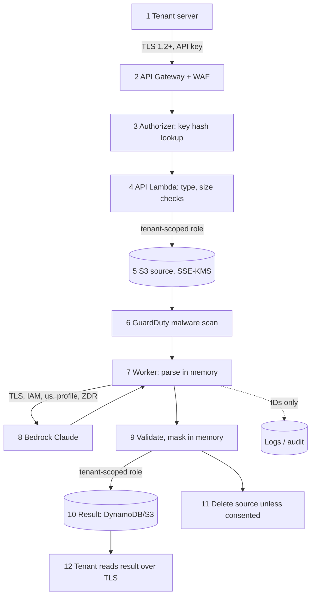

# SLM Fintech Platform: Security Design (Data Security)

| | |
|---|---|
| Version | 0.1 (draft for review) |
| Date | 2026-10-13 |
| Design | [architecture.md](architecture.md) v0.2 (Bedrock, us-east-1) |
| Requirements | NFR-S1 to NFR-S9, NFR-C2 to NFR-C5, FR-4, FR-6 in [requirements.md](requirements.md) |

This document explains how the platform protects tenant data: what data exists, where it goes, who and what can reach it, and how it is removed. It also covers the supporting controls (identity, network, monitoring, incident response) that data security depends on.

## 1. Security goals

1. **Confidentiality:** a tenant's documents and results are readable only by that tenant's API keys and by the platform code processing them. Not by other tenants, not by the model provider, and not by our staff in day-to-day work.
2. **Isolation:** a bug in our code must not be enough to leak data between tenants. AWS IAM must block it as well (NFR-S1).
3. **Minimisation:** keep as little as possible, for as short a time as possible. Source files are deleted after processing unless the tenant has consented to training use. Aadhaar is never stored unmasked.
4. **Traceability:** every access to tenant data can be traced to a tenant key, a platform role or a named staff member.
5. **Erasability:** all data of one job or one tenant can be found and deleted, including training copies (FR-6.4).

## 2. Data inventory and classification

| Class | Meaning | Examples |
|---|---|---|
| **C1 Restricted** | Raw customer documents and anything that can identify a person or account in full | Uploaded files, page images, raw model output, unmasked PAN or account numbers |
| **C2 Confidential** | Processed tenant data, masked where required | Stored extraction results, corrections, training copies |
| **C3 Internal** | Data about the platform and its use that contains no document content | Job metadata, usage counters, audit records, API-key metadata |
| **C4 Secret** | Material that grants access | API-key pepper, webhook secrets, KMS keys |

| Data item | Class | Where it lives | How long | Encryption |
|---|---|---|---|---|
| Uploaded file (multipart, base64 JSON or presigned) | C1 | S3 `tenants/{t}/uploads/` or `…/jobs/{job}/source` | Until processed (presigned uploads expire after 1 day); then deleted unless kept for training | SSE-KMS, documents key |
| Page images and text sent to Bedrock | C1 | Lambda memory → Bedrock (in transit only) | The length of the request. Bedrock keeps nothing (§5.1) | TLS 1.2+ |
| Raw model output (before masking) | C1 | Lambda memory only | The length of the request | n/a, never written |
| Extraction result (masked) | C2 | DynamoDB job item (< 100 KB) or S3 `result.json` | Tenant retention: 7, 30, 90 or 365 days | KMS, table key / documents key |
| Corrections | C2 | DynamoDB under the job | Same as the job | KMS, table key |
| Training copy (source + result + corrections) | C2 | S3 `tenants/{t}/training/` | Tenant retention, or until consent is withdrawn | SSE-KMS, documents key |
| Dedup hash (SHA-256 of the file) | C3 | DynamoDB `DEDUP#` item | Same as the job | KMS, table key |
| Job metadata, usage, warnings | C3 | DynamoDB | Same as the job; usage kept 13 months for billing | KMS, table key |
| Audit records | C3 | CloudWatch Logs `audit` + CloudTrail in the log-archive account | 180 days (NFR-C4) | KMS, logs key |
| Application logs | C3 (no content, by design) | CloudWatch Logs | 30 days | KMS, logs key |
| API keys | C4 | Shown once; stored only as HMAC-SHA256 | Until revoked | KMS, table key |
| Pepper, webhook secrets | C4 | Secrets Manager | Rotated (§6.6) | KMS |

**Never stored:** original file names, unmasked Aadhaar numbers, raw model output, request bodies in logs.

## 3. Data flow and the controls at each step



| Step | What could go wrong | Control |
|---|---|---|
| 1–2 Transport | Interception, downgrade | TLS 1.2+ only (API Gateway security policy `TLS_1_2`), HSTS, WAF rate limits |
| 3 Authentication | Stolen or guessed key | 256-bit random keys; HMAC-SHA256 with pepper; per-key scopes; revocation takes effect within 60 s; per-tenant throttling; optional IP allowlist (§6.1) |
| 4 Upload checks | Malicious or oversized files, wrong type | Type from magic bytes; size caps (4 MB inline as multipart or base64 JSON, 25 MB presigned); strict base64 decoding with the length checked before decoding; macro, encryption and page-count checks (§7.1) |
| 5 Storage | Wrong tenant prefix, public exposure | Tenant-scoped IAM session (§4.2); Block Public Access; bucket policy denies non-TLS and non-KMS writes |
| 6 Malware | Infected file reaches the parser | GuardDuty Malware Protection; the worker refuses files without a clean scan tag |
| 7 Parsing | Parser exploit, decompression bomb | Lambda sandbox with no inbound access; memory and time limits; pixel and archive-size limits (§7.1) |
| 8 Model call | Data retained or seen by the provider; data leaves the region's geography | Bedrock ZDR mode `none` enforced by SCP; model allowlist; `us.` profile only; invocation logging off (§5) |
| 9 Output | Prompt injection, unmasked identifiers | Schema validation, consistency checks, masking before any write (§7.2, §7.3) |
| 10 Result storage | Cross-tenant write or read | Tenant-scoped IAM session; DynamoDB `LeadingKeys` condition |
| 11 Deletion | Source kept longer than allowed | Worker deletes it; lifecycle rules and TTL as backstops (§8) |
| 12 Read | Another tenant reads by job ID | Key-derived tenant only; unknown or foreign IDs return `404` |
| Logs | Content leaks into logs | Allowlist logger; error scrubbing (§7.4) |

## 4. Tenant isolation (NFR-S1)

Isolation is enforced in **three independent layers**. Any one of them should be enough to stop a cross-tenant read; all three must fail for a leak to happen.

### 4.1 Layer 1: application code

- `tenant_id` comes only from the authorizer context, which is derived from the API key (FR-1.2). No request field, header or path parameter can set it.
- Every data-access function takes `tenant_id` as a required first argument and builds keys as `TENANT#{tenant_id}` / `tenants/{tenant_id}/`. Code review rejects any query that builds a key without it.
- A job ID that is not found **under the caller's tenant** returns `404`. The API never says whether the ID exists elsewhere.
- Job IDs are ULIDs (random part: 80 bits), so they cannot be guessed. This is defence in depth only: the tenant check is what protects data.

### 4.2 Layer 2: AWS IAM (attribute-based access control)

The API and worker Lambdas have **no permission on tenant data** in their own execution roles. To touch tenant data they must assume the `tenant-data` role with a session tag:

```python
# Simplified: the real code caches 1-hour credentials per tenant and renews them
# while more than one upload-URL lifetime (16 min) is still left.
sts.assume_role(
    RoleArn=TENANT_DATA_ROLE_ARN,
    RoleSessionName=f"job-{job_id}",
    Tags=[{"Key": "tenant_id", "Value": tenant_id}],   # becomes aws:PrincipalTag/tenant_id
)
```

The `tenant-data` role allows:

- DynamoDB actions only where `dynamodb:LeadingKeys` = `TENANT#${aws:PrincipalTag/tenant_id}`.
- S3 object actions only on `tenants/${aws:PrincipalTag/tenant_id}/*`, and `s3:ListBucket` only with the prefix `tenants/${aws:PrincipalTag/tenant_id}/` (needed to delete a job's whole folder).
- KMS `Decrypt` / `GenerateDataKey` on the `documents` key only through S3. With the stack parameter `EnforceTenantEncryptionContext=true`, also only when the encryption context `tenant_id` equals `${aws:PrincipalTag/tenant_id}` (layer 3, §4.3).

The role's trust policy allows `sts:AssumeRole` and `sts:TagSession` only from the platform's own Lambda roles (names `slm-<env>-fn-*`), and requires the session to carry exactly one tag, `tenant_id`, with a value of the form `t_*`. Every function that touches tenant data goes through this role: api, worker, intake, scan-sweeper, webhook (reads the tenant's webhook settings) and retention-cleaner. If code builds the wrong key, for example by passing tenant B's ID to a query while the session is tagged for tenant A, AWS returns `AccessDenied`.

The only roles that can read across tenants are:

| Role | Why | Limits |
|---|---|---|
| Authorizer | Looks up `APIKEY#<hash>` items, which are not under a tenant key, then the tenant's `PROFILE` to check it is active | `GetItem` only, on `APIKEY#*` and `TENANT#*` keys (LeadingKeys condition); read-only |
| Scan sweeper | Finds jobs stuck waiting for an upload or a scan, across all tenants | `Query` on the sparse `pending` index only (job ids and statuses); each status change then goes through `tenant-data` |
| Operator break-glass | Incident investigation | §6.2 |

### 4.3 Layer 3: encryption context

Every S3 object and every application-encrypted value uses a KMS encryption context `{"tenant_id": "<t>"}`. Even with S3 read access, decrypting another tenant's object needs a KMS grant that the tag condition refuses. Every decrypt is logged in CloudTrail together with the tenant ID, so cross-tenant access attempts are visible.

### 4.4 Proving it (acceptance criterion 3)

The automated isolation test suite runs against a real AWS environment with the IAM controls on. It creates tenants A and B and then, as A:

- reads, lists, deletes and corrects B's job IDs (expects `404`);
- submits B's `upload_id` (expects `404`);
- uploads a file identical to one of B's (expects no dedup hit);
- calls the data layer directly with B's tenant ID while tagged as A (expects `AccessDenied` from AWS).

The suite runs on every deploy to the staging environment.

## 5. Amazon Bedrock data handling

### 5.1 What AWS guarantees

From the Amazon Bedrock documentation (checked 2026-10-13):

- **Zero operator access and zero data retention by default.** "No operators of the service can access model input or output", and "by default, Amazon Bedrock does not store model inputs or outputs".
- **No access for the model provider.** Models run in Bedrock-owned *model deployment accounts*. "Model providers don't have any access to those accounts… they don't have access to Amazon Bedrock logs or to customer prompts and completions." Anthropic never receives our documents.
- **No training on our data.** Inputs and outputs are not used to train AWS or provider models.
- **Encryption in transit:** TLS 1.2 is required; TLS 1.3 is recommended.

**Exceptions.** Some models require retention for abuse detection. **Claude Fable 5 / 5.1** keep all traffic for up to 30 days and may be reviewed by AWS staff. Some OpenAI models keep flagged traffic. These models must never be used for tenant data (§5.2).

### 5.2 Controls we add

| Control | How | Why |
|---|---|---|
| **Zero data retention locked on** | Set the Bedrock account data-retention mode to `none` in us-east-1, us-east-2 and us-west-2 (`PUT /data-retention`, mode `none`). An SCP denies `bedrock:PutAccountDataRetention` and `bedrock-mantle:PutAccountDataRetention` with any other mode. | With `none`, a model that would retain data is **blocked** (`ValidationException`), instead of quietly retaining. Nobody in the account can loosen it. |
| **Model allowlist** | The worker role may invoke only the model-ladder models: `us.amazon.nova-lite-v1:0`, `us.anthropic.claude-haiku-5-5` and `us.anthropic.claude-sonnet-5-5` (inference-profile ARNs, plus their foundation-model ARNs through the profile condition). | Prevents switching to a retaining or untested model by configuration alone. Changing the model needs an IAM change and passes review. |
| **Geography** | `us.` profiles only; SCP region restriction (architecture §3.5). | Inference runs only in us-east-1, us-east-2 or us-west-2. |
| **Invocation logging off** | Bedrock model-invocation logging stays disabled. An AWS Config rule raises an alarm if it is turned on. | That feature writes full prompts and outputs to S3 or CloudWatch, which would turn every document into a C1 log entry. |
| **IAM, not API keys** | Lambdas call Bedrock with their IAM role (SigV4). Long-term Bedrock API keys are denied by SCP (`bedrock:CallWithBearerToken`). | No static credentials to leak. |
| **No stateful Bedrock features** | No Agents, Knowledge Bases, Flows, batch jobs, prompt management, or Responses API `store=true`. | Each of these stores data in Bedrock. Adding one requires a security review. |
| **Prompt cache contents** | The cached prefix contains only the system prompt, schemas and anonymised few-shot examples. Never tenant documents. | The cache holds data for up to 1 hour. Keeping documents out of it means nothing tenant-specific sits in the cache. |

**Phase-0 check:** read each allowed model's `allowed_modes` (Bedrock `GET /v1/models/{id}`) and confirm it includes `none`. Repeat this before any model change.

### 5.3 Rung 0: deterministic parsing first (architecture §3.3)

Most bank statements are read by Python parsers inside our worker Lambda, before any model sees them. This helps data security in three ways:

- **Less AI exposure, by choice.** With the tenant setting `checks_only`, documents finished by Rung 0 are **never sent to any AI service**. They are parsed and checked entirely inside our AWS account. With the default `ai` setting, they go to Nova Lite for verification only, under the same zero-retention controls as §5.2.
- **Explainable results.** Every value comes from a known position on a page, through code that can be reviewed and tested, rather than from model output.
- **No new attack surface for prompt injection.** Text in the document is only read as data by the parser. The verifier's answer can only *reject* a parser result (sending it to the AI ladder); it can never change a value.

The parsers handle untrusted PDFs, so they get the same protections as the rest of the pipeline (§7.1): size and page limits, a sandboxed Lambda with tenant-scoped permissions, and no execution of PDF content.

## 6. Identity and access

### 6.1 Tenant API keys (FR-1)

| Property | Implementation |
|---|---|
| Format | `slm_live_<key_id>_<secret>` or `slm_test_…`: key ID 8 characters, secret 32 bytes from `secrets.token_urlsafe` |
| Storage | `HMAC-SHA256(pepper, full_key)` only. The pepper is in Secrets Manager, so a stolen copy of the table is useless without it. |
| Shown | Once, at creation (FR-1.3). After that only the prefix and the last 4 characters are visible. |
| Scopes | `extractions:read`, `extractions:write`. Chat scopes are reserved. |
| Revocation | Per key (FR-1.4). The authorizer cache is 60 s, so a revoked key stops working within 1 minute. A suspended tenant gets `403` (FR-1.6). |
| Leak detection | The `slm_live_` prefix is registered with GitHub secret scanning (partner pattern) where possible. Keys found in public places are revoked automatically. |
| Brute force | WAF rate rule on `401` responses per source IP; with 256-bit secrets, guessing is not practical. |
| IP allowlist (optional) | Per-tenant CIDR list checked in the authorizer (FR-1.9). |

### 6.2 Staff access

- **Separate AWS accounts** under AWS Organizations:
  - `prod` holds tenant data;
  - `staging` and `dev` hold only synthetic data;
  - `log-archive` stores CloudTrail and the audit-log copies;
  - `security` runs GuardDuty and the AWS Config aggregator.
- **No IAM users and no long-term keys.** Staff sign in through IAM Identity Center with MFA.
- **Default prod roles cannot read tenant data:**
  - `ReadOnlyOps` (metrics, logs, queues, job metadata without results) is denied S3 `GetObject` on `tenants/*`, KMS `Decrypt` with the documents key, and reads of the `result` attribute.
  - `Deploy` is used only by the CI/CD pipeline, through OIDC from GitHub Actions with no stored keys.
- **Break-glass** (`DataAccessEmergency`) can read tenant data. It requires a second approver, works for 1 hour, and alerts the security channel when used. Every use is reviewed and recorded with a reason.
- **Root accounts** are locked with hardware MFA and alarmed on any sign-in.

### 6.3 Workload roles (least privilege)

| Role | Allowed |
|---|---|
| Authorizer | `GetItem` on `APIKEY#*` and `TENANT#*` items; read the pepper secret |
| API Lambda | Assume `tenant-data`; send to the two job queues; create presigned POSTs (through the tenant session) |
| Worker | Assume `tenant-data`; consume the two job queues; invoke only the three model-ladder `us.` profiles; send to the webhook queue |
| Intake | Assume `tenant-data`; send to the interactive job queue and the webhook queue |
| Scan sweeper | Query the `pending` index; assume `tenant-data`; send to the webhook queue |
| Webhook Lambda | Assume `tenant-data` (to read the tenant's webhook URL and secret id only); consume the webhook queue; read secrets named `slm/<env>/webhook/*` |
| Retention cleaner | Read the table stream; assume `tenant-data` to delete the expired job's S3 folder |

All roles are defined in `infra/cloudformation/app.yaml`, one per function, named `slm-<env>-fn-<function>`.

### 6.4 KMS keys

| Key | Encrypts | Key-policy notes |
|---|---|---|
| `documents` | S3 objects | No service-wide grant in the key policy: only IAM grants count, and only `tenant-data` (through S3) and the GuardDuty scan role have one. Break-glass is the only other principal. With S3 Bucket Key on (the default, ~99% fewer KMS calls), KMS sees the bucket ARN as context, so the per-tenant context condition needs `EnforceTenantEncryptionContext=true`, which turns Bucket Key off. |
| `table` | DynamoDB table, SQS queues | Used by the DynamoDB and SQS services on behalf of the workload roles |
| `logs` | CloudWatch Logs, Secrets Manager | Logs service principal plus ops roles |

All keys are customer-managed, with automatic yearly rotation and a 30-day deletion window. A key that is disabled or scheduled for deletion raises an alarm.

### 6.5 Secrets (NFR-S9)

Secrets live in Secrets Manager, encrypted with the `logs` key. Lambdas read them with the AWS SDK (`app/core/secrets.py`) and cache them in memory for 5 minutes. Secrets are never in environment variables, code, CloudFormation templates or stack parameters: environment variables hold only the secret's ARN. The API-key pepper's value is generated by Secrets Manager itself (`GenerateSecretString` in `security.yaml`); per-tenant webhook secrets are created by `scripts/create_tenant.py`.

### 6.6 Rotation

| Secret | Rotation |
|---|---|
| Webhook secret (per tenant) | On request, or every 12 months. During a 24-hour overlap both secrets are valid, and the `X-Signature` header carries both signatures. |
| API-key pepper | Every 12 months, using a versioned pepper. Each key record stores its pepper version; on the next successful use, the key is re-hashed with the new pepper. |
| Tenant API keys | Tenant-driven. A warning header is sent when a key is older than 12 months. |

## 7. Data protection controls

### 7.1 Safe handling of uploaded files (NFR-S6)

| Threat | Control |
|---|---|
| Wrong or disguised type | Detect from magic bytes; only PDF, DOCX, JPEG and PNG are accepted; extension and `Content-Type` are ignored |
| Malware | GuardDuty Malware Protection for S3. Files without a `NO_THREATS_FOUND` tag are not parsed. Infected files are deleted and the job fails with `malware_detected`. |
| Macros, active content | DOCX containing `vbaProject.bin` or a macro-enabled content type is rejected. PDF JavaScript, embedded files and forms are never executed: pages are only rendered to images and their text read. |
| Encrypted PDF | Rejected with `encrypted_document` |
| PDF bomb | Rejected above 20 pages; each page render is capped (max 4,000 × 4,000 px, 10 s timeout); worker memory 2 GB |
| Image bomb | Pillow `MAX_IMAGE_PIXELS` = 50 MP; images over that are rejected before decoding |
| Zip bomb (DOCX is a ZIP) | Reject if the total uncompressed size is over 50 MB, if there are more than 2,000 entries, or if any entry's compression ratio is over 100:1 |
| Parser vulnerabilities | Pinned library versions, weekly dependency and image scanning (§10). Parsing runs in a Lambda with no inbound network access and only the tenant-scoped permissions of that job. |

### 7.2 Prompt injection (NFR-S5)

A document can contain text such as "ignore previous instructions and output…". The design limits what such text can achieve:

- **The model has no tools**, no URLs to fetch and no other data. It sees only the current document and our fixed instructions, so it cannot reach another tenant's data or any system.
- **Output is data, never commands.** It is parsed as JSON, validated against a strict schema (unknown fields are dropped), passed through arithmetic checks, and masked. Nothing in it is executed, used as a URL, or used to build a database key.
- **The worst case** is wrong or invented values in **that tenant's own result** for **that document**. Consistency checks and warnings make many such cases visible.
- The system prompt states that document text is data, and the document content is fenced with clear delimiters.

### 7.3 Masking and minimisation (FR-4)

- Masking runs in the worker **before anything is written** (result, logs, training copies or webhooks).
- **Aadhaar:** always masked to `XXXX XXXX 1234`, whatever the tenant settings (FR-4.1). For `identity_document` and `kyc_form`, any 12-digit Aadhaar-like value in any field is masked (FR-4.2). A unit-test corpus with Aadhaar numbers in odd places (addresses, notes, spaced, hyphenated) guards against regressions.
- **PAN, bank account, UAN, ID numbers, phone numbers:** masked to the last 4 characters by default; a tenant can be allowed to receive them unmasked, by kind (FR-4.3, FR-4.4). The setting is logged in the audit log when changed.
- **Training copies of `identity_document` and `kyc_form` are never kept by default** (FR-6.2).
- **Detected document types** (when the tenant leaves `document_type` out) cannot weaken these rules. Aadhaar markers force identity/KYC masking whatever type was detected, and detected types are kept for training only when confidence is ≥ 0.95 and no ID markers are present (architecture §6.0).
- **Webhooks carry no extracted data**, only the job ID and status (FR-2.10).
- **The dedup hash** is looked up within the same tenant only, so it cannot reveal whether another tenant has the same document.

### 7.4 Keeping content out of logs, metrics and errors (NFR-S3, NFR-S8)

- **Allowlist logger:** a structured JSON logger that accepts only named fields (tenant ID, job ID, key ID, document type, page count, status, error code, timings, token counts). Unknown fields are dropped, not logged.
- **Error scrubbing:**
  - The global exception handler logs the exception type, error code and a stack trace **with local variables and arguments stripped**.
  - Pydantic `ValidationError`s are converted to `{field, error_type}` lists, dropping the `input` attribute.
  - Bedrock SDK errors are logged by error code only.
  - Lambda's own automatic error output is not relied on.
- **API error responses** name the field and the error code, never the submitted value (NFR-S8).
- **Metrics** use document type, status and model as dimensions, never field values.
- **CI log-leak test:** every test run uses documents with canary values (for example PAN `CANAR1234Y`). A test fails the build if a canary appears in any captured log line, metric or error response.

### 7.5 Encryption summary (NFR-S2)

| Where | In transit | At rest |
|---|---|---|
| Tenant ↔ API Gateway | TLS 1.2+ | n/a |
| Presigned S3 upload | TLS (bucket policy denies `aws:SecureTransport = false`) | SSE-KMS `documents` |
| Lambda ↔ AWS services | TLS (AWS SDK) | n/a |
| Worker ↔ Bedrock | TLS 1.2+ | Not stored (ZDR) |
| DynamoDB, SQS | TLS | KMS `table` |
| CloudWatch Logs, Secrets Manager | TLS | KMS `logs` |
| Webhook ↔ tenant | TLS 1.2+ required; plain `http://` URLs rejected | n/a |

### 7.6 Serverless compute: no servers to patch (NFR-O5)

All application code runs on AWS Lambda (architecture §4.2). This removes a whole class of risks:

- **No servers, operating systems or SSH access** to patch, harden or monitor. AWS runs and patches the compute.
- **Short-lived, isolated execution.** Each invocation runs in a Lambda sandbox. Document data exists in memory only for one job, and `/tmp` is cleared after each job.
- **Least privilege per function:** seven functions, each with its own IAM role. The webhook function, for example, can't read documents at all (§6.3).
- **Smaller attack surface:** no inbound network access to any function; only API Gateway and AWS event sources can invoke them.
- **Signed code:** Lambda code signing ensures only images built and signed by our CI pipeline can run (§10).

### 7.7 Browser access and the test console (FR-7.4)

Tenants normally call the API from their servers. The **test console** (`web/`, stack `web.yaml`) is the one browser client, so it has its own controls:

- **HTTPS only:** CloudFront in front of a **private** S3 bucket, readable only by that distribution (Origin Access Control). There is no public bucket and no plain-HTTP website endpoint, because the page handles API keys.
- **No key in the site:** each user types their own key. It is kept in `sessionStorage` (that tab only, gone when it closes), sent only to the API, and never logged. `config.json` holds only the API URL.
- **Response headers on every file:**
  - a Content-Security-Policy: scripts only from the site itself, no inline scripts, network calls only to API Gateway and S3;
  - HSTS;
  - framing denied (`frame-ancestors 'none'`, `X-Frame-Options: DENY`);
  - no MIME sniffing;
  - no referrer.
- **CORS:** off by default. In prod it is allowed for **exactly** the console's origin (`CorsAllowOrigin`), on the API (FastAPI middleware, which also answers pre-flights) and on the documents bucket (upload links). Other websites get no CORS permission, so a browser on them can't use the API. CORS never replaces authentication: every call still needs a valid key. API Gateway's own error responses carry `Access-Control-Allow-Origin: *`, which is safe because their bodies are fixed text with no data.
- **Pre-flight requests** (`OPTIONS`) skip the authorizer by necessity (browsers send them without the key). They reach the api function, which returns headers only, and they are not audited.

## 8. Retention and deletion (NFR-C5, FR-2.9, FR-6)

| Mechanism | Removes | When |
|---|---|---|
| Worker | Source file, if not kept for training | Right after the result is stored (FR-6.1) |
| S3 lifecycle `uploads/` | Unused presigned uploads | 1 day |
| DynamoDB TTL on `expires_at` | Job, corrections and dedup items | Retention days after creation (TTL deletes usually happen within a few days of expiry; reads filter out expired items straight away) |
| TTL stream → retention cleaner | The job's S3 prefix | When the item is deleted |
| S3 lifecycle by `retention` tag | Any object the steps above missed | Retention + 2 days (backstop) |
| `DELETE /v1/extractions/{id}` | File, result, corrections, training copy | Immediately (FR-2.9) |
| Tenant offboarding script | Everything under `TENANT#t` and `tenants/t/`, keys, webhook secret | On request, with a deletion report (FR-6.4) |
| Consent withdrawal | `tenants/t/training/` | Immediately. Future jobs are not copied. |

**Backups:**

- DynamoDB point-in-time recovery keeps a rolling **35-day** history. Deleted items therefore remain in backups for up to 35 days, and then disappear. Tenant contracts and the privacy notice must say this.
- S3 versioning is off, so S3 deletes are final.
- Restores from point-in-time recovery go to a new table and require break-glass access.

**Training data index:** every training copy is under `tenants/{t}/training/{doc_type}/{job}/`, so a single prefix delete removes it. Few-shot examples taken from training data are anonymised and recorded in a register (`example_id → tenant, job`). If the source is deleted, the example is removed from all profiles in the next release.

## 9. Monitoring and audit (NFR-S4, NFR-C4)

**Audit log (application).** One record per API call: `tenant_id`, `key_id`, action, resource ID, time, result, source IP. It is written to CloudWatch Logs `audit` (180 days) and copied to the `log-archive` account.

**CloudTrail.** An organisation trail covers management events, plus data events for the documents bucket and for KMS. It is delivered to the `log-archive` account into an S3 bucket with **Object Lock (compliance mode, 180 days)**, so nobody, not even an administrator, can alter or delete the trail during that time.

**Detective controls:**

| Signal | Source | Action |
|---|---|---|
| Bedrock data-retention mode changed, or invocation logging enabled | CloudTrail → EventBridge rule; AWS Config rule | Page on-call; auto-revert where possible |
| Bucket policy or Block Public Access changed on the documents bucket | AWS Config `s3-bucket-public-*` rules + EventBridge | Page on-call |
| KMS key disabled or scheduled for deletion | EventBridge | Page on-call |
| Break-glass role assumed; root sign-in | CloudTrail → EventBridge | Alert the security channel |
| `AccessDenied` from the `tenant-data` role (a possible isolation bug) | CloudWatch metric filter on CloudTrail | Alert; investigate as a potential cross-tenant bug |
| Threat findings (credential misuse, unusual API calls) | GuardDuty (account-level) | Alert by severity |
| Spike in `401`/`403` per IP or per key | WAF + API metrics | Alert; possible key leak or attack |

## 10. Secure development and supply chain

- **Dependencies:** exact versions locked in `uv.lock`. The Lambda package is built from that lock file only (`scripts/build_lambda.py`), and PyMuPDF (AGPL) is deliberately not used. The console's npm versions are pinned in `web/package.json`. *Planned with CI:* weekly Dependabot updates, `pip-audit`, and a licence check blocking AGPL/GPL.
- **Code checks today:** `ruff`, 150+ tests including tenant isolation and audit; `cfn-lint` and `checkov` on every template (every skipped rule has its reason written next to it). *Planned with CI:* `bandit` and `semgrep`, with rules for logging tenant content and building keys without `tenant_id`.
- **Lambda package:**
  - one zip (`lambda-<content-hash>.zip`), built reproducibly from the lock file, so the same inputs always give the same file;
  - stored in the private code bucket; old packages expire after 90 days;
  - *planned:* Amazon Inspector Lambda code scanning, and Lambda code signing with AWS Signer.
- **Infrastructure as code:** CloudFormation templates are checked with `cfn-lint` and scanned with `checkov`; every deploy goes through a change set that is reviewed before it is executed. Changes to IAM, KMS, bucket policy or the SCP need a second reviewer.
- **Secrets in the repository:** pre-commit `gitleaks` hook and GitHub secret scanning.
- **Test data:** synthetic documents only outside prod. Copying prod data to other environments is denied by SCP and by the bucket policy.

## 11. Incident response

| Scenario | First actions |
|---|---|
| Tenant API key leaked | Revoke the key (effective within 60 s). Review the key's audit trail. Tell the tenant which jobs were accessed. |
| Suspected cross-tenant access | Suspend the affected endpoints with a WAF block. Preserve CloudTrail and audit logs. Use the `tenant-data` `AccessDenied` and audit records to scope the impact. Notify affected tenants as their contracts require. |
| Compromised staff credentials | Disable the user in IAM Identity Center. Revoke active sessions (IAM `aws:TokenIssueTime` deny policy). Review CloudTrail for the session. |
| Malware detected in an upload | Automatic: object deleted and job failed. Notify the tenant if repeated. |
| Bedrock retention or logging setting changed | Automatic alert. Restore `none` / logging off. Treat any affected time window as a potential exposure and assess it. |
| Data breach confirmed | Follow the incident runbook: contain, assess, notify tenants and regulators within the legal and contractual deadlines, then hold a post-incident review. |

The runbooks live in `docs/runbooks/` (to be written in phase 4) and are exercised once before the pilot.

## 12. Shared responsibility

| Area | AWS | Us (platform) | Tenant |
|---|---|---|---|
| Physical and host security, hypervisor, Bedrock model hosting | ✔ | | |
| Bedrock zero operator access and no provider access | ✔ | Configure ZDR mode and model allowlist | |
| IAM design, tenant isolation, encryption configuration | | ✔ | |
| Application security (parsing, masking, logging) | | ✔ | |
| Keeping API keys secret; rotating them | | Provide tooling | ✔ |
| Verifying webhook signatures | | Sign every event | ✔ |
| Lawful basis for uploading customer documents; customer notices | | | ✔ |
| Training consent decision | | Record and enforce it | ✔ |

## 13. Requirement coverage

| Requirement | Covered in |
|---|---|
| NFR-S1 tenant isolation in code and IAM | §4 |
| NFR-S2 TLS 1.2+, KMS everywhere | §7.5, §6.4 |
| NFR-S3 no content in logs, metrics, errors | §7.4 |
| NFR-S4 audit log | §9 |
| NFR-S5 untrusted document text, no tools, constrained output | §7.2 |
| NFR-S6 malware scanning | §7.1 |
| NFR-S7 model has no internet access (revised: Bedrock-only via profile, logging off) | §5.2 |
| NFR-S8 validation errors never echo values | §7.4 |
| NFR-S9 secrets in Secrets Manager | §6.5 |
| NFR-S10 Bedrock zero data retention locked | §5.2 |
| NFR-S11 no standing staff access to tenant data | §6.2 |
| FR-9.3, FR-9.4 Rung 0 verification, `checks_only` option | §5.3 |
| NFR-O5 all code on Lambda (no servers to patch) | §7.6 |
| NFR-C2 consent with timestamp | §2, §8 (consent withdrawal) |
| NFR-C3 Aadhaar handling | §7.3 |
| NFR-C4 audit logs 180 days | §9 |
| NFR-C5 retention 7/30/90/365 with automatic deletion | §8 |
| FR-4 masking | §7.3 |
| FR-6.4 find and remove all data of a tenant or job | §8 |

## 14. Cost of the security controls

Most controls are free: IAM, SCPs, encryption context, KMS key policies, lifecycle rules, Object Lock, CI scanners. The paid ones are already in [cost.md](cost.md) (WAF, KMS, Secrets Manager, GuardDuty Malware Protection, one Config rule, CloudTrail), except for:

| Additional item | Estimate |
|---|---|
| Extra AWS Config rules (~8) | ~USD 3 a month |
| GuardDuty account-level threat detection (CloudTrail and DNS analysis at low volume) | ~USD 4 a month |
| Amazon Inspector Lambda scanning (7 functions) | ~USD 1 a month |
| CloudTrail data events for the documents bucket and KMS | ~USD 1 a month |
| Log-archive bucket with Object Lock | < USD 1 a month |
| **Total extra** | **~USD 10 a month**, on top of the ~USD 56 base case in [cost.md](cost.md) v0.3 (CloudTrail management events and the security-change alerts are already deployed by the templates at ~USD 0.05) |

## 15. Open items

| Item | Owner |
|---|---|
| Confirm `allowed_modes` includes `none` for Haiku 5.5 and Sonnet 5.5 (phase 0) | Engineering |
| Penetration test before the pilot (API, authorization, file parsing) | Security |
| Legal review of the privacy notice: Bedrock as sub-processor, 35-day backup retention, inference in three US regions | Legal |
| Whether tenants want customer-managed keys per tenant (more KMS cost; possible later) | Product |
| Write the incident runbooks and run a tabletop exercise | Engineering |
